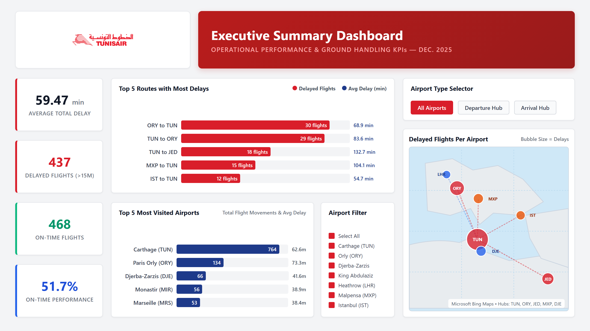
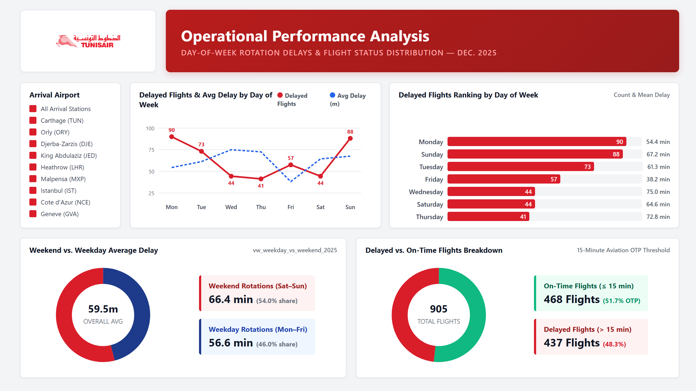
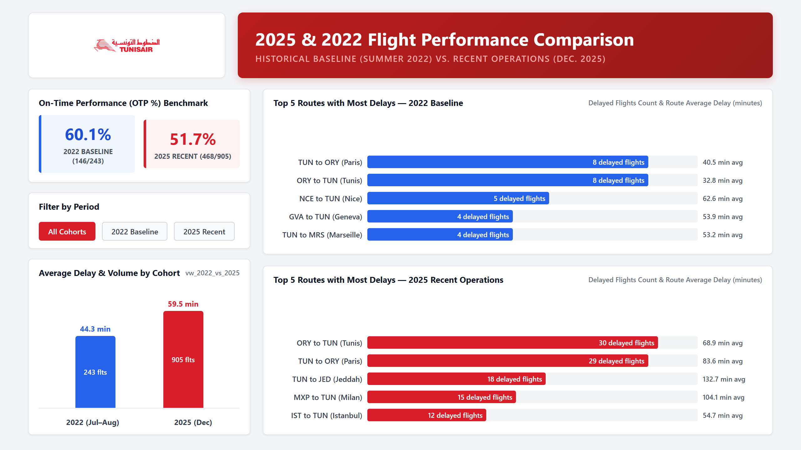
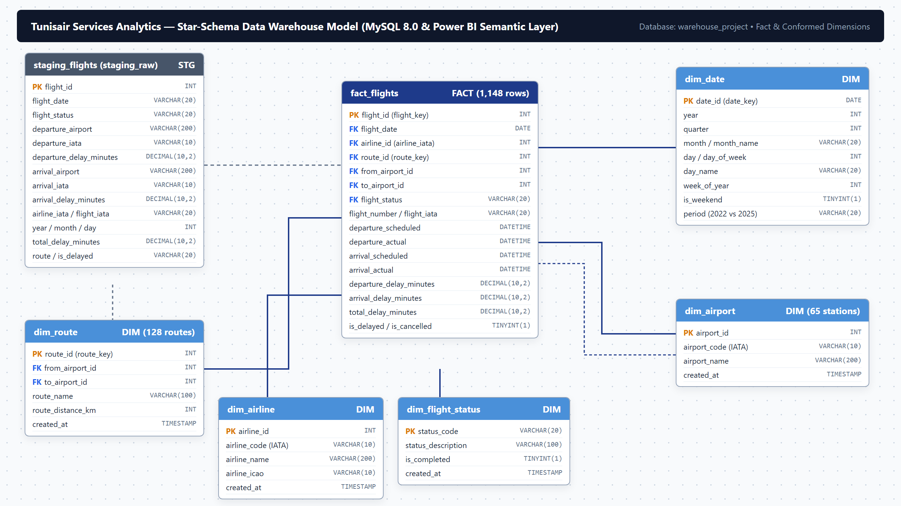
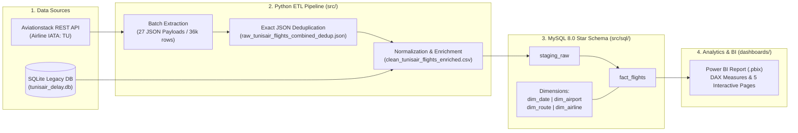

<div align="center">


# Tunisair Services — Operations & Performance Analytics (Power BI)

**End-to-End Aviation Data Engineering, Star-Schema Data Warehousing & Executive Power BI Analytics**

[](dashboards/)
[](src/)
[](src/sql/)
[](src/)
[](src/step2_extract_tunisair.py)

</div>

---

## 1. Executive Summary & Business Problem

### Business Context
**Tunisair (Société Tunisienne de l'Air)** and **Tunisair Services** operate a high-density network connecting North Africa (Carthage `TUN`, Djerba-Zarzis `DJE`, Monastir `MIR`, Sfax `SFA`) with major European, Middle Eastern, and African hubs (Paris Orly `ORY`, London Heathrow `LHR`, Jeddah `JED`, Geneva `GVA`, Nice `NCE`, Montreal `YUL`).

In commercial aviation and ground handling operations, **schedule reliability and turnaround efficiency** directly dictate fleet utilization, gate/slot compliance, crew rotation stability, and passenger satisfaction. Compounding delays at primary hubs (`TUN`, `ORY`) trigger cascading knock-on disruptions across multi-leg rotations.

### The Analytical Solution
This project delivers an end-to-end **Aviation Operations & Performance Analytics Platform** that:
1. **Extracts & Deduplicates Live Flight Telemetry:** Harvests 36,062 raw flight status records across 27 extraction batches from the **Aviationstack API** and merges historical SQLite operational logs (`tunisair_delay.db`), deduplicating and normalizing them into **1,148 unique flight operations** across **64+ airports** and **127+ directional routes**.
2. **Models a Star-Schema Enterprise Data Warehouse:** Structures messy semi-structured JSON and legacy operational exports into a relational **MySQL 8.0 Star Schema** (`fact_flights`, `dim_airline`, `dim_airport`, `dim_route`, `dim_date`).
3. **Tracks Executive & Operational KPIs in Power BI:** Enables aviation operations managers to monitor **On-Time Performance (OTP %)**, **Departure vs. Arrival Turnaround Delays**, **Route & Airport Bottlenecks**, **Weekday vs. Weekend Congestion**, and **Longitudinal Benchmarking (2022 Historical Baseline vs. 2025 Recent Performance)**.

---

## 2. Dashboard Preview (Screenshots)

| Executive Overview (`01_executive_overview.png`) | Operational KPIs & Day-of-Week Analysis (`02_operations_kpis.png`) |
| :---: | :---: |
|  |  |
| **Executive Summary Dashboard (2025 & 2022):** High-level KPI cards (`On-Time Performance %`, `Avg Total Delay`, `On-Time Flights`, `Delayed Flights`), geospatial map of airport delay hotspots, interactive Origin/Destination airport slicers, and Top Delayed Routes bar charts. | **Operational Performance Analysis:** Day-of-week delay trends (`Monday`–`Sunday`), flight status composition donut charts (`Scheduled`, `Landed`, `Active`, `Diverted`, `Cancelled`), and `Weekday vs. Weekend` average delay distribution. |

| Historical vs. Recent Benchmarking (`04_historical_comparison.png`) | Star-Schema Data Model (`03_data_model.png`) |
| :---: | :---: |
|  |  |
| **Historical vs. Recent Flight Performance (2022 vs. 2025):** Side-by-side longitudinal comparison of OTP %, average turnaround delays, and route-level bottleneck shifts between the 2022 summer peak baseline and 2025 operations. | **Relational Star-Schema Architecture:** Central `fact_flights` table joined to conformed dimensions (`dim_date`, `dim_airport`, `dim_route`, `dim_airline`, `dim_flight_status`) and analytical SQL views. *(Full PDF diagram available in [`docs/warehouse_diagram.pdf`](docs/warehouse_diagram.pdf))*. |

---

## 3. Key KPIs & Metrics Tracked

The Power BI report and underlying SQL analytical views track standard **IATA / ICAO aviation ground-handling and flight performance metrics**:

- **On-Time Performance (OTP %):** Percentage of flights operating within the industry-standard **15-minute delay tolerance** (`total_delay_minutes <= 15`).
  $$\text{OTP \%} = \frac{\text{On-Time Flights } (\text{Total Delay} \le 15\text{ min})}{\text{Total Operated Flights}} \times 100$$
- **Total Flights & On-Time Flights (`FlightCount`, `on_time_flights`):** Volume of scheduled, active, and landed flight movements filtered by airport, route, or period.
- **Delayed Flights Count (`DelayedFlightsCount`, `DelayedFlights2022`):** Number of flights breaching the 15-minute threshold (`is_delayed = True`).
- **Average Total Delay (`AvgTotalDelay`):** Mean cumulative delay per flight (`departure_delay_minutes + arrival_delay_minutes`), with an overall dataset mean of **56.3 minutes** (median **10.0 minutes**, 75th percentile **83.3 minutes**).
- **Departure vs. Arrival Delay Split:**
  - **Mean Departure Delay:** `23.16 minutes` (reflecting gate turnaround, boarding, and ground handling efficiency).
  - **Mean Arrival Delay:** `33.11 minutes` (reflecting en-route air traffic control, holding patterns, and arrival slot congestion).
- **Average Delay & Visits per Airport (`AverageDelayPerAirport`, `Total Airport Visits`):** Station-level performance ranking across departure and arrival hubs (`TUN`, `ORY`, `DJE`, `JED`, `LHR`, `GVA`, `NCE`).
- **Route Performance (`vw_route_performance_2025`):** Directional corridor delay intensity (e.g., `TUN to ORY`, `ORY to DJE`, `TUN to JED`) to isolate chronic bottleneck routes.
- **Temporal & Weekend Congestion (`vw_weekday_vs_weekend_2025`):** Comparison of operational delays across days of the week (`Monday`–`Sunday`) and `Weekday` vs. `Weekend` rotation schedules.
- **Period-over-Period Variance (`vw_2022_vs_2025_delay_compare`):** Longitudinal shift in OTP % and average delay between 2022 and 2025 cohorts.

---

## 4. Data Architecture & Tech Stack



### Technology Stack
| Layer | Tools & Technologies | Purpose |
| :--- | :--- | :--- |
| **Data Ingestion** | `Python 3.9+`, `requests`, `sqlite3`, **Aviationstack API** | Automated paginated extraction of Tunisair (`TU`) flight telemetry & historical SQLite database export. |
| **Data Transformation (ETL)** | `pandas`, `numpy`, `Jupyter Notebooks` | Nested JSON flattening (`pd.json_normalize`), exact record hashing/deduplication (36,062 $\rightarrow$ 957 API records + 2022 historical records = 1,148 enriched rows), mixed-format date parsing (`DD/MM/YYYY` & `ISO-8601` $\rightarrow$ `YYYY-MM-DD`), and feature engineering. |
| **Data Warehousing** | **MySQL 8.0** (`InnoDB`, `utf8mb4`) | Bulk `LOAD DATA INFILE` into `staging_raw` and star-schema modeling across `fact_flights` and 4 conformed dimension tables (`dim_airline`, `dim_airport`, `dim_date`, `dim_route`). |
| **Business Intelligence** | **Power BI Desktop**, `DAX`, `Power Query (M)` | Interactive 5-page executive and operational dashboard with dynamic airport slicers, geospatial mapping, and longitudinal 2022 vs. 2025 benchmarking. |

---

## 5. Repository Structure

```text
Tunisair-Services-Analytics/
├── assets/
│   └── screenshots/                                  # Dashboard screenshots, ERD images & branding
│       ├── tunisair_logo.png                         # Official Tunisair brand logo extracted from report
│       ├── 01_executive_overview.png                 # Executive Summary Dashboard (2025)
│       ├── 02_operations_kpis.png                    # Operational Performance Analysis (2025)
│       ├── 03_data_model.png                         # Star-Schema Data Warehouse & Power BI Model view
│       └── 04_historical_comparison.png              # Historical vs. Recent Flight Performance (2022 vs 2025)
├── dashboards/
│   └── Final Power BI Report - Tunisair.pbix         # Interactive Power BI Desktop report (5 pages)
├── data/
│   ├── raw/                                          # Unmodified source datasets & API payloads
│   │   ├── raw_tunisair_flights.json                 # Aviationstack API batch 1 (through batch 27)
│   │   ├── raw_tunisair_flights[2..27].json          # Auto-incremented raw JSON extraction batches
│   │   ├── raw_tunisair_flights_combined.json        # Combined raw payload (>50MB, git-ignored)
│   │   ├── tunisair_delay.db                         # Original SQLite database of 2022 flight delays
│   │   └── tunisair_delay_export.csv                 # Raw table export from tunisair_delay.db
│   └── processed/                                    # Cleaned, deduplicated & enriched modeling datasets
│       ├── clean_tunisair_flights_enriched.csv       # Final analytics-ready dataset (1,148 rows, 27 cols)
│       ├── clean_tunisair_flights.csv                # Cleaned dataset prior to route string normalization
│       ├── raw_tunisair_flights_combined_dedup.json  # Deduplicated JSON payload (957 unique API flights)
│       ├── Tunisair2022.csv                          # Historical 2022 benchmark flight dataset
│       └── tunisair_delay_export_TU.csv              # Filtered Tunisair (AIRLINE == 'TU') 2022 records
├── docs/
│   ├── data_dictionary.md                            # Full schema documentation & field definitions
│   └── warehouse_diagram.pdf                         # Relational Star-Schema Entity-Relationship Diagram (ERD)
├── src/
│   ├── step1_test_api.py                             # Aviationstack API connectivity & status check script
│   ├── step2_extract_tunisair.py                     # CLI script for single-batch Tunisair (TU) extraction
│   ├── Tunair_etl.ipynb                              # Primary ETL notebook (Extract -> Combine -> Dedupe -> Clean)
│   ├── clean_flights_enrichment.ipynb                # Date normalization, feature engineering & enrichment
│   ├── convertdbcsv.ipynb                            # SQLite (tunisair_delay.db) to CSV extraction & TU filter
│   └── sql/                                          # MySQL 8.0 Data Warehouse DDL & DML scripts
│       ├── warehouse_project_staging_raw.sql         # Staging table DDL (staging_raw)
│       ├── Insert.sql                                # Bulk CSV ingestion (LOAD DATA INFILE)
│       ├── warehouse_project_fact_flights.sql        # Fact table DDL (fact_flights) & foreign keys
│       ├── warehouse_project_dim_airline.sql         # Airline dimension DDL (dim_airline)
│       ├── warehouse_project_dim_airport.sql         # Airport dimension DDL (dim_airport)
│       ├── warehouse_project_dim_date.sql            # Calendar date dimension DDL (dim_date)
│       └── warehouse_project_dim_route.sql           # Origin-Destination route dimension DDL (dim_route)
├── .gitignore                                        # Git ignore rules for Power BI, Python & >50MB raw files
└── README.md                                         # Project documentation & portfolio overview
```

---

## 6. How to Run / Open the Report

### Option A: Open the Power BI Dashboard Directly (Quickest)
1. Install **[Microsoft Power BI Desktop](https://powerbi.microsoft.com/desktop/)** (free).
2. Open [`dashboards/Final Power BI Report - Tunisair.pbix`](dashboards/Final%20Power%20BI%20Report%20-%20Tunisair.pbix).
3. **To Refresh or Re-point Data Sources:**
   - In Power BI Desktop, go to **Home** $\rightarrow$ **Transform data** $\rightarrow$ **Data source settings**.
   - If connecting via CSV/local files, point the source path to `data/processed/clean_tunisair_flights_enriched.csv` and `data/processed/Tunisair2022.csv`.
   - If connecting via MySQL (`warehouse_project`), ensure your local MySQL 8.0 instance is running on `127.0.0.1` and click **Refresh**.

### Option B: Reproduce the Python ETL Pipeline
1. **Clone the repository & install dependencies:**
   ```bash
   git clone https://github.com/<your-username>/Tunisair-Services-Analytics.git
   cd Tunisair-Services-Analytics
   pip install pandas numpy requests jupyter
   ```
2. **Run the ETL Notebooks in `src/`:**
   - Open [`src/convertdbcsv.ipynb`](src/convertdbcsv.ipynb) to extract and filter `TU` records from `data/raw/tunisair_delay.db`.
   - Open [`src/Tunair_etl.ipynb`](src/Tunair_etl.ipynb) to combine `data/raw/raw_tunisair_flights*.json`, deduplicate records, flatten nested JSON fields, and export `clean_tunisair_flights.csv`. *(Note: Update paths to `../data/raw/` and `../data/processed/` if running from inside `src/`).*
   - Open [`src/clean_flights_enrichment.ipynb`](src/clean_flights_enrichment.ipynb) to normalize mixed date formats and generate [`data/processed/clean_tunisair_flights_enriched.csv`](data/processed/clean_tunisair_flights_enriched.csv).

### Option C: Build the MySQL Star-Schema Data Warehouse
1. Open **MySQL Workbench** or the MySQL 8.0 CLI.
2. Execute the DDL scripts in [`src/sql/`](src/sql/) in the following order:
   1. `warehouse_project_staging_raw.sql`
   2. `warehouse_project_dim_airline.sql`
   3. `warehouse_project_dim_airport.sql`
   4. `warehouse_project_dim_date.sql`
   5. `warehouse_project_dim_route.sql`
   6. `warehouse_project_fact_flights.sql`
3. Update the file path in [`src/sql/Insert.sql`](src/sql/Insert.sql) to point to your local `data/processed/clean_tunisair_flights_enriched.csv` and execute it to populate `staging_raw`.
